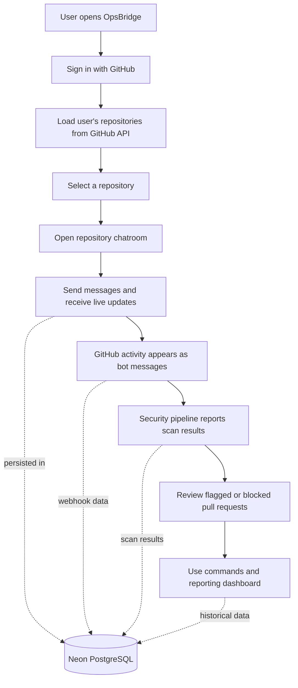
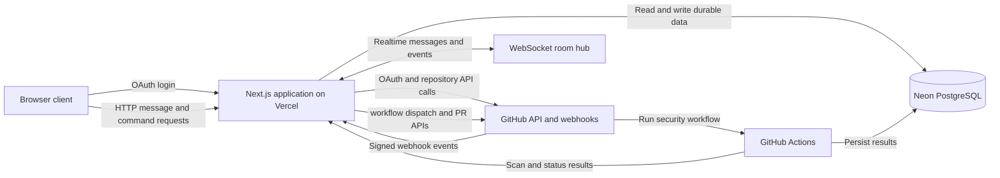
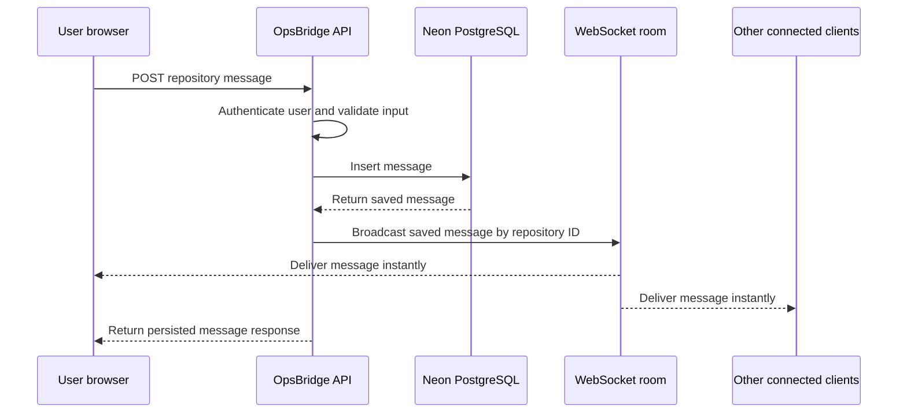
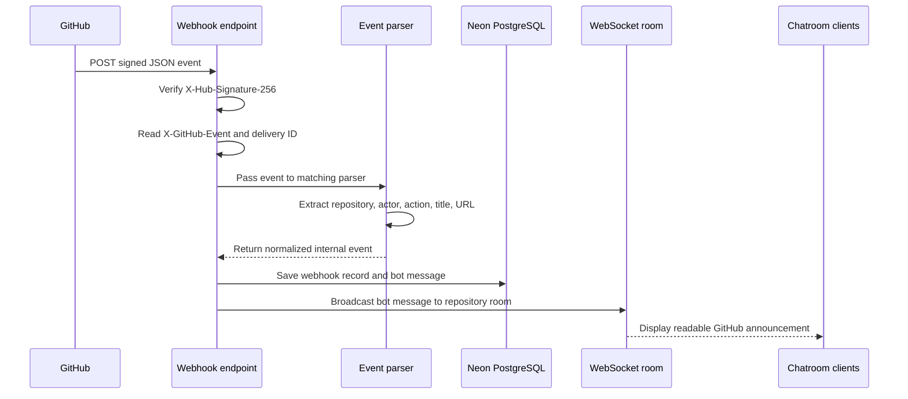
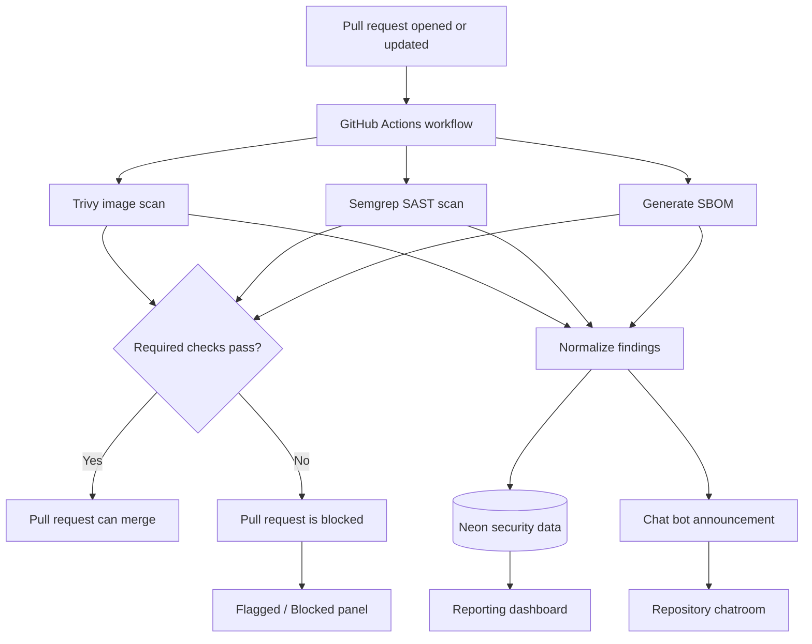

# OpsBridge

OpsBridge is a GitHub-native DevSecOps collaboration platform. It combines repository conversations, GitHub activity, security gates, pull-request workflows, and engineering reports in one repository-scoped workspace.

Users sign in with GitHub, select a repository, and work from its dedicated live chatroom. GitHub activity and security results appear as readable messages, while Neon PostgreSQL keeps the complete history available after refreshes and reconnects.

## What OpsBridge provides

- GitHub OAuth authentication
- Live repository discovery from the GitHub API
- A dedicated chatroom for every repository
- Persistent messages backed by Neon PostgreSQL
- Instant two-way realtime communication through WebSocket
- GitHub webhook activity announcements
- Trivy container vulnerability scanning
- Semgrep static application security testing
- SBOM generation
- Required security checks for pull requests
- Flagged and blocked pull-request visibility
- Chat commands for rerunning scans and managing pull requests
- Repository health and security reporting dashboards

## Product flow



## Architecture



Neon is the durable source of truth. WebSockets provide immediate delivery to connected clients; they do not replace database persistence. If a client is offline, it receives the complete history from Neon when it reconnects or reloads the chatroom.

## Realtime message flow



## GitHub event flow

GitHub events enter OpsBridge through an HTTPS webhook request. The webhook is separate from the WebSocket connection: GitHub sends an HTTP request to the server, and the server later broadcasts the normalized event to connected browsers.



For example, a large `pull_request` payload is reduced to a concise message:

```text
🤖 @paramshah opened PR #12: “Fix login bug”
```

The parser uses the event type and action to select the correct fields. Pushes, pull requests, merges, scan results, and command responses each have their own normalized message format.

## DevSecOps pipeline



The security pipeline records both successful and failed stages. A failed required check blocks the pull request through GitHub branch protection and is also reflected in the repository chatroom and dashboard.

## Chat commands

Commands are parsed deterministically and return structured results in the repository chatroom.

```text
/rerun-trivy-scan
/rerun-semgrep
/rerun-full-pipeline
/raise-pr <head> <base> "<title>"
/status
/help
```

- Scan commands trigger the corresponding GitHub Actions workflow through the GitHub API.
- `/raise-pr` creates a pull request through the GitHub API.
- `/status` retrieves the current pull-request and security-gate state.
- Every command execution is saved and produces a visible result message.

## Reporting dashboard

The dashboard is repository-scoped and uses accumulated data from Neon. It includes:

- Pass/fail history over time
- Severity breakdown for security findings
- Stage-failure frequency
- Flagged and blocked pull requests
- Scan and workflow details
- Time-window filtering

## Technology stack

| Area | Technology |
| --- | --- |
| Frontend | Next.js App Router, React, TypeScript |
| Hosting | Vercel |
| Authentication | GitHub OAuth |
| Repository integration | GitHub REST API and webhooks |
| Realtime transport | Native WebSocket upgrade with `ws` |
| Database | Neon PostgreSQL |
| Security scanning | Trivy and Semgrep |
| Artifact generation | SBOM tooling in GitHub Actions |
| CI/CD | GitHub Actions and Vercel deployments |

## Local development

### Requirements

- Node.js 20 or newer
- npm
- A GitHub OAuth App
- A Neon PostgreSQL database

Use `npm` or `npx` for project commands.

### Install

```bash
npm install
```

### Environment variables

Create `.env.local` from `.env.example`:

```env
GITHUB_CLIENT_ID=your_github_oauth_client_id
GITHUB_CLIENT_SECRET=your_github_oauth_client_secret
NEXT_PUBLIC_APP_URL=http://localhost:3000
SESSION_SECRET=replace_with_a_long_random_secret
DATABASE_URL=your_neon_connection_string
GITHUB_WEBHOOK_SECRET=your_webhook_secret
```

The GitHub OAuth callback for local development is:

```text
http://localhost:3000/api/auth/github/callback
```

### Database setup

Run the SQL schema in `db/schema.sql` in the Neon SQL Editor. The schema contains the repository-scoped messages and the persisted data required by the chat, webhook, security, command, and reporting features.

### Run the application

```bash
npm run dev
```

Open [http://localhost:3000](http://localhost:3000).

### Verify a production build

```bash
npm run build
npm run start
```

The definitive WebSocket test should be performed through the Vercel deployment because the production runtime handles the WebSocket upgrade route.

## Vercel deployment

1. Import the repository into Vercel.
2. Add all environment variables for the Preview and Production environments.
3. Set `NEXT_PUBLIC_APP_URL` to the deployed HTTPS URL without a trailing slash.
4. Set the GitHub OAuth callback to:

   ```text
   https://your-domain.vercel.app/api/auth/github/callback
   ```

5. Configure the GitHub webhook URL:

   ```text
   https://your-domain.vercel.app/api/webhooks/github
   ```

6. Use `application/json` as the webhook content type and configure the same secret in GitHub and Vercel.
7. Push to the connected GitHub repository. Vercel automatically builds and deploys the application.

## Security model

- GitHub access tokens remain server-side in encrypted, HttpOnly cookies.
- OAuth state protects the login callback from request forgery.
- Webhook signatures are verified before GitHub events are processed.
- Repository access is checked against the signed-in GitHub user.
- Messages and security results are scoped by GitHub repository ID.
- Secrets are stored in environment variables, never committed to the repository.
- GitHub Actions checks and branch protection enforce the merge gate.
- Webhook delivery IDs provide duplicate-event protection.

## Application routes

```text
GET  /                         Landing page and GitHub login
GET  /repos                    Repository picker
GET  /repos/[id]/chat          Repository chatroom

GET  /api/auth/github          Start GitHub OAuth
GET  /api/auth/github/callback Complete GitHub OAuth
GET  /api/auth/logout          Sign out
POST /api/auth/logout          Sign out
GET  /api/repos                List accessible GitHub repositories
GET  /api/repos/[id]/messages  Load repository message history
POST /api/repos/[id]/messages  Save a repository message
POST /api/webhooks/github      Receive signed GitHub events
GET  /api/ws                   Upgrade to the realtime WebSocket connection
```

## Repository structure

```text
app/
├── api/
│   ├── auth/github/            GitHub OAuth routes
│   ├── repos/                  Repository and message APIs
│   ├── webhooks/github/        GitHub event receiver
│   └── ws/                     WebSocket upgrade route
├── components/                 Shared client components
├── repos/[id]/chat/             Repository chatroom page
├── lib/
│   ├── db.ts                   Neon database connection
│   ├── realtime.ts             Repository WebSocket room hub
│   └── session.ts              Session and token handling
└── globals.css                 Application styling

db/schema.sql                   PostgreSQL schema
.github/workflows/              Security and CI workflows
.env.example                    Environment variable template
next.config.mjs                 Next.js and WebSocket configuration
```

## Data ownership and reliability

Neon stores durable application data. The in-process WebSocket room hub stores only active connections and is used for delivery, not persistence. This separation means a disconnected client can recover messages from the database, while connected clients receive new activity immediately.

The application treats GitHub as the source of truth for repository, pull-request, workflow, and permission data. OpsBridge stores normalized copies of relevant events and results so they can be searched, displayed in chat, and used for reporting.

## License

This project is currently maintained as a private application. Add the project license here when the repository is opened for external use.
